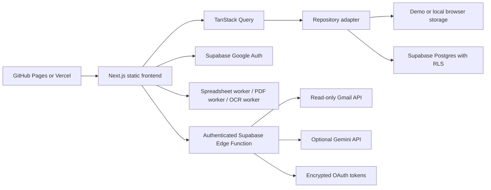
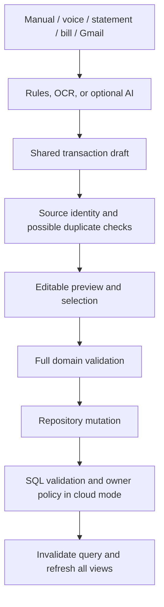

# Architecture

## Goals and boundaries

SpendPulse is a single-owner application with an independently deployable static frontend. Manual tracking is the primary capability; external services are optional enhancements. It must remain useful without a Gemini key, Google OAuth setup, or a continuously running server.

The public frontend must never become an authorization boundary. Google login supplies identity; Supabase policies and server checks decide access. The static host stores no financial records. The same frontend bundle architecture works on GitHub Pages and Vercel.

## Source organization

| Location | Responsibility |
| --- | --- |
| `src/app/` | Static app shell, metadata, global theme and Tailwind styles |
| `src/components/` | Feature views, accessible dialogs, review/edit forms |
| `src/hooks/use-finance.ts` | Query keys, data retrieval, mutation invalidation |
| `src/lib/schema.ts` | Zod schemas and inferred domain types |
| `src/lib/finance.ts` | Pure accounting, date, formatting, and recommendation functions |
| `src/lib/repository.ts` | Browser/cloud persistence and integration calls |
| `src/lib/parser.ts` | English/Manglish text and receipt rules |
| `src/lib/documents.ts` | File extraction, OCR orchestration, mapping, source hashing |
| `src/workers/` | Spreadsheet parsing away from the UI thread |
| `supabase/migrations/` | Tables, policies, validation, and atomic imports |
| `supabase/functions/integrations/` | Authenticated Google/AI operations and OAuth callback |
| `tests/` | Domain and end-to-end acceptance checks |

Components and utilities use arrow functions. Domain functions avoid React/browser state so they can be tested independently. TypeScript is strict. Zod validates forms, restores, persistence reads, and external payloads. SQL constraints/triggers provide an independent server-side validation layer.

## Rendering and navigation

Next.js exports the app as static HTML/CSS/JS. The shell is prebuilt without private data. Browser hydration reads the chosen repository. Feature navigation is hash-based within the exported root route, so GitHub Pages does not require SPA rewrite rules. The month selector controls the reporting period independently of each transaction’s date.

There are no Next Server Actions, request-time Server Components, or private API routes. Supabase hosts private operations. PDF and OCR packages are dynamically imported when needed; the spreadsheet library is isolated in a worker. PDF worker assets are copied during build and referenced through the configured base path.

## Persistence and schema

The logical backup shape is `{ version: 1, transactions, preferences }`. In local/demo modes, separate localStorage keys hold this validated document. Cloud mode stores transactions as individual rows plus one preferences row per owner.

`transactions` contains an indexed UUID, owner UUID, source key, timestamp, and validated JSONB domain payload. JSONB keeps the shared browser/backup type intact while allowing per-row changes and RLS. The generated linked-transaction column has a foreign key to prevent orphaned refunds/settlements.

| Domain field | Meaning |
| --- | --- |
| `amountPaise` | Positive gross transaction amount |
| `kind` | expense, income, refund, transfer, or reimbursement |
| `personalSharePaise` | Owner’s allocated share of an expense |
| `settledPaise` | Friends’ payments recorded manually on the split |
| `linkedTransactionId` | Original expense for a refund or reimbursement |
| `excluded` | Omit from regular-spending/income calculations |
| `categoryId`, `accountId` | Stable IDs into owner preferences |
| `source`, `sourceKey`, `importId` | Origin, deduplication, and batch undo provenance |
| `date` | Calendar date in the owner’s reporting context |

Preferences contain categories/icons/colors, accounts/last-four/billing/milestones, budgets, planned income, account allocation, theme, speech language, the AI toggle, and verified reward rules. Full card numbers, bank passwords, document passwords, and raw audio are not part of the model.

Cloud imports run inside one Postgres transaction. The database unique index rejects repeated source keys; UUID conflicts are ignored for idempotent restore. Import undo removes only records bearing that batch ID and respects dependent credit links. Restoring preferences is a separate operation from merging transactions; keep the backup if a restore is interrupted.

## Accounting rules

1. All persisted money is integer paise. Decimal text is parsed without binary floating-point multiplication for manual amounts.
2. Regular personal spend is the sum of non-excluded expense shares minus allocated linked refunds.
3. A reimbursement settles the friends’ receivable. It does not reduce personal spend a second time and is not salary/income.
4. Refunds are allocated proportionally to the original personal share. Cumulative refunds are capped at the original bill, with deterministic rounding. They affect the month received.
5. Transfers and credit-card repayments do not count as expenses or income. A card purchase is the expense event.
6. Actual income comes from income entries, not the planned salary setting. Actual savings = actual income − regular personal spend; no savings percentage is shown when actual income is zero.
7. Excluded purchases remain visible in the ledger and cash outflow. They are not included in regular-spending KPIs.
8. Planned income and category budgets drive the simulator only. Fixed commitments are not injected into actual records.
9. Outstanding splits = gross expense − personal share − manually recorded returns − linked reimbursement credits, floored at zero.

## Input and review pipeline

File SHA-256 hashes plus sheet/row identity detect repeated imports. Gmail IDs provide exact provenance. Same-date, same-amount, normalized-merchant matches across inputs are candidates, not automatic merges. Potential duplicates are deselected, and an existing transaction can be edited instead. This conservative approach can miss differently named cross-source duplicates; it avoids silently collapsing legitimate repeated purchases.

PDF text is extracted first. Image-only pages are rendered and OCR’d sequentially. The table parser expects conservative date/description/amount rows, while spreadsheet users can map columns. A receipt extractor seeks an unambiguous final payable total. Unknown fields remain unresolved for review rather than being guessed.

## Authentication and service boundaries

The owner email is configured in a private database allowlist, not in the public bundle. A before-user-created hook rejects other signups. RLS independently joins the confirmed user identity to the allowlist. Enable both; hiding a UI control is never sufficient.

Edge Function POST requests validate the Supabase user JWT, owner policy, allowed Origin, input schema, and request size. Gmail OAuth callbacks cannot carry the normal user JWT; they instead consume a hashed random state with a short expiry, bind to the initiating owner, and use PKCE. Refresh tokens use AES-GCM encryption with a separately managed secret key.

Gmail connects separately from app sign-in. Ten messages are processed per page. The UI reviews/saves before requesting another page; exact-source deduplication makes restarting a range safe. The continuation token is currently held in the UI, so closing/reloading restarts scanning rather than resuming a durable job.

## AI control

AI is enabled for new cloud ledgers and invoked on request through the authenticated backend. The Edge Function requires a Gemini secret and checks the owner’s AI preference. Gmail sync requires a separate checkbox to send unresolved alerts to Gemini. Parsing output is constrained to JSON and validated with Zod. The function treats content as data and redacts long numbers and email addresses from extracted document text. AI actions on bill images send the selected image.

The function makes requests without a SpendPulse monthly cap. The follow-up migration retires the old reservation RPC and preserves historical records. Google applies its quota and billing settings to provider usage.

## Extensibility

- Add an input adapter by returning `TransactionDraft` values and reusing preview/validation.
- Add a new AI provider behind `callIntegration`; do not expose keys to browser code.
- Add issuer-specific parsers with anonymized fixtures and debit/credit/refund tests.
- For larger ledgers, add paged cloud queries and aggregate SQL functions without changing the transaction schema.
- For automatic background Gmail sync, add a durable job table/queue; do not extend one Edge request indefinitely.
- For multiple owners, revise the product and authorization model deliberately; removing the signup hook alone is insufficient.
